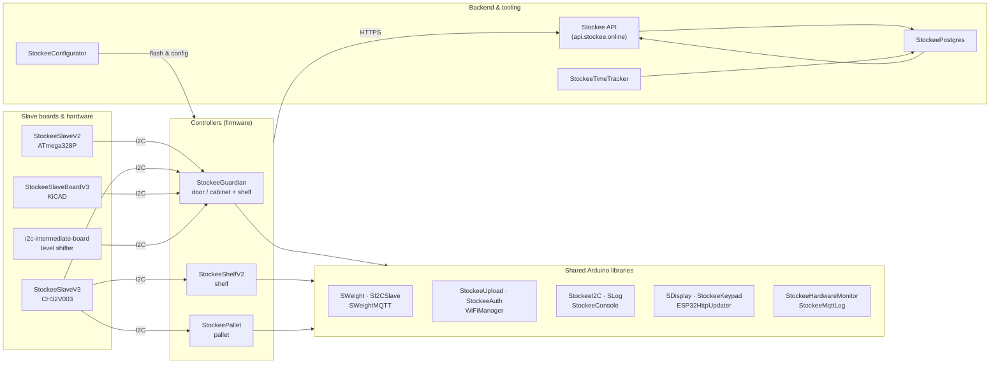

# Stockee

**Smart stock, made simple.**

Stockee is an automated reordering system built around weight-sensing shelves. Every
bin, pallet and cabinet continuously reports how much is left, and the system emails
your suppliers the moment stock runs low — so inventory restocks itself, 24/7.

## How it works

Weight sensors under each shelf measure stock in real time. A small ESP32 controller
reads those sensors over I²C, sends the data to the Stockee API, and the dashboard
updates live. When stock dips below its threshold, a reorder email goes out to your
designated supplier automatically.

The controllers share one codebase of libraries; the slave boards handle the raw
weight sensing and the backend ties the whole fleet together.

## What lives here

### Controllers (firmware)

| Repo | What it is |
| --- | --- |
| [StockeeGuardian](https://github.com/Stockee-Pty-Ltd/StockeeGuardian) | Door / cabinet controller. The same firmware also flashes as a Shelf controller via `STOCKEE_MODE_SHELF`, so one board does double duty. |
| [StockeeShelfV2](https://github.com/Stockee-Pty-Ltd/StockeeShelfV2) | Weight-based shelf controller that watches stock and reports what changed. |
| [StockeePallet](https://github.com/Stockee-Pty-Ltd/StockeePallet) | Pallet-scale controller for bigger loads. |

### Shared Arduino libraries

| Repo | What it is |
| --- | --- |
| [SWeight](https://github.com/Stockee-Pty-Ltd/SWeight) | Multiple HX711 load cells on one SCK bus, with per-device calibration. |
| [SI2CSlave](https://github.com/Stockee-Pty-Ltd/SI2CSlave) | I²C slave for reading load cells. |
| [SWeightMQTT](https://github.com/Stockee-Pty-Ltd/SWeightMQTT) | Publishes weight readings over MQTT. |
| [StockeeUpload](https://github.com/Stockee-Pty-Ltd/StockeeUpload) | WiFi + config + HTTPS upload. |
| [StockeeAuth](https://github.com/Stockee-Pty-Ltd/StockeeAuth) | Auth and session handling. |
| [StockeeWiFiManager](https://github.com/Stockee-Pty-Ltd/StockeeWiFiManager) | WiFi setup wrapper (with a modified `WiFiManager` fork). |
| [StockeeI2C](https://github.com/Stockee-Pty-Ltd/StockeeI2C) | I²C bus manager and slave code. |
| [SLog](https://github.com/Stockee-Pty-Ltd/SLog) | Logging. |
| [StockeeConsole](https://github.com/Stockee-Pty-Ltd/StockeeConsole) | Serial console. |
| [SDisplay](https://github.com/Stockee-Pty-Ltd/SDisplay) | OLED display. |
| [StockeeKeypad](https://github.com/Stockee-Pty-Ltd/StockeeKeypad) | Keypad and card reader. |
| [ESP32HttpUpdater](https://github.com/Stockee-Pty-Ltd/ESP32HttpUpdater) | Over-the-air firmware updates. |
| [StockeeHardwareMonitor](https://github.com/Stockee-Pty-Ltd/StockeeHardwareMonitor) | I²C fault detection. |
| [StockeeMqttLog](https://github.com/Stockee-Pty-Ltd/StockeeMqttLog) | MQTT log streaming. |

### Slave boards & hardware

| Repo | What it is |
| --- | --- |
| [StockeeSlaveV2](https://github.com/Stockee-Pty-Ltd/StockeeSlaveV2) | Slave firmware for ATmega328P boards. |
| [StockeeSlaveV3](https://github.com/Stockee-Pty-Ltd/StockeeSlaveV3) | Slave firmware for CH32V003 boards. |
| [StockeeSlaveBoardV3](https://github.com/Stockee-Pty-Ltd/StockeeSlaveBoardV3) | KiCAD hardware design for the slave board. |
| [i2c-intermediate-board](https://github.com/Stockee-Pty-Ltd/i2c-intermediate-board) | I²C level-shifter / intermediate board (PCA9508DP). |

### Backend & tooling

| Repo | What it is |
| --- | --- |
| [StockeePostgres](https://github.com/Stockee-Pty-Ltd/StockeePostgres) | Database schema, migrations and the backend that powers the dashboard. |
| [StockeeConfigurator](https://github.com/Stockee-Pty-Ltd/StockeeConfigurator) | Flash and serial configuration tool for controllers. |
| [StockeeTimeTracker](https://github.com/Stockee-Pty-Ltd/StockeeTimeTracker) | Time tracking tooling. |

## The idea

Walk up. Scan a card. The door opens, the shelf notices, the pallet knows.
Inventory updates itself — no clipboards, no guesswork.

Firmware ships as ready-to-flash binaries; libraries ship as source zips. See the
releases tab of each repo.

---

[stockee.com.au](https://stockee.com.au) · Owned & operated by [Aim Inventory](https://aiminventory.com.au/products/stockee-smart-shelf/) · `+61 1300 948 544` · `sales@aiminventory.com.au`

